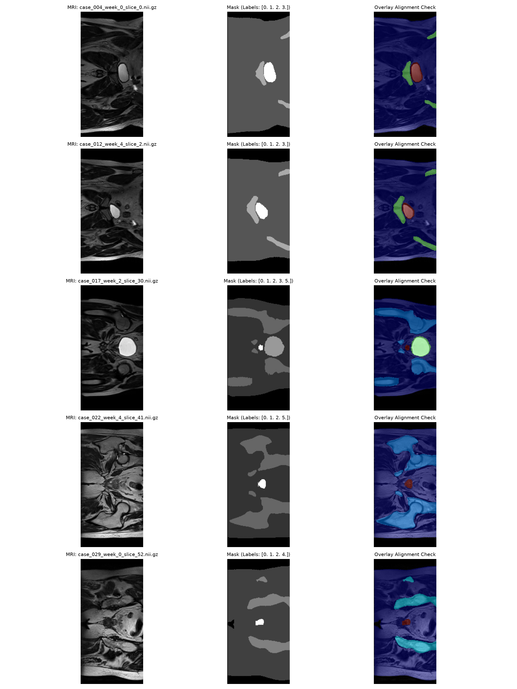

# 2D Improved U-Net for Pelvic Organ Segmentation in Prostate Radiotherapy Planning (HipMRI)

**Student Name:** Don Loretto Jayasekera
**Student ID:** 48016825
**Course:** COMP3710 Pattern Analysis
**Repository Branch:**  `topic-recognition`
**Target Topic:** Project 2.2 - HipMRI Prostate Radiotherapy Planning

---

## 1. Project Overview & Working Principles:

### 1.1 Problem Description:
The project addresses the problem of multi-organ pelvic segmentation in 2D Magnetic Resonance Imaging (MRI) scans for targeted prostate radiotherapy planning. Manual contouring by clinicians is labor-intensive, time-consuming and subject to inter-observer variability. Accurate automated segmentation is essential for identifying the Clinical Target Volume (CTV: Prostate, Label 3) while delineating surrounding Organs at Risk (OARs), such as the bladder, rectum and pelvic bones.

Correctly segmenting these anatomical structures supports radiotherapy planning by helping clinicians ensure that therapeutic radiation is delivered to the prostate while limiting radiation exposure to surrounding healthy tissues, thereby preventing severe clinical complications such as radiation proctitis or rectal wall damage. However, automated segmentation is computationally challenging due to two primary factors:
- **Extreme Class Imbalance:** The prostate occupies less than 2% (~1.95%) of the total slice volume, creating extreme class imbalance between the prostate and the surrounding background/organs, that can cause unweighted loss functions to be dominated by background pixels.
- **Low Soft-Tissue Contrast:** Ambiguous soft-tissue contrast in MRI scans can make the boundaries between the prostate and adjacent structures, particularly the rectum and bladder, difficult to distinguish accurately.

*Figure 1.1: Representative pelvic MRI slices from the HipMRI dataset alongside ground-truth multi-organ segmentation masks and spatial color overlays*

---

### 1.2 Algorithm Working Principles:
To solve this task, this project implements and benchmarks two 2D convolutional encoder-decoder architectures in `modules.py`:

1. **Baseline 2D U-Net (Baseline_UNet):** A standard 4-level U-Net architecture featuring double-convolution blocks (`ConvBlock`) that contains two consecutive $3 \times 3$ convolution operations, each followed by batch normalization and ReLU activation:
    $$\text{[Conv2d}(3\times 3) \longrightarrow \text{BatchNorm2d} \longrightarrow \text{ReLU}] \times 
    2$$
The encoder extracts increasingly abstract image features through convolutional blocks and $2 \times 2$ max-pooling operations. The decoder progressively restores spatial resolution using $2 \times 2$  transposed convolutions. Cross-level skip connections transfer feature maps from corresponding encoder level to decoder levels, preserving spatial information that may otherwise be lost during downsampling.

2. **Improved 2D U-Net (Improved_UNet):** The improved U-Net builds on baseline architecture by using residual blocks in place of standard double-convolution blocks. Each residual block learns a feature transformation, $F(x)$, which is combined with a shortcut connection $S(x)$: 
    $$y = \text{ReLU}(F(x) + S(x))$$
When the input and output channel dimensions match, an identity shortcut (`nn.Identity()`) is used. When the channel dimensions differ, a $1 \times 1$ convolution with batch normalization projects the input features to match output dimensions. These shortcut connections preserve gradient flow through deep encoder stages, accelerating convergence and improving boundary feature propagation without excessive parameter growth. 

---

### 1.3 Tensor Flow & Anatomical Class Definitions: 
Both models process single-channel 2D MRI slices and produce a 6-class segmentation prediction for every pixel. 

#### Tensor Flow Architecture:
$$\text{Input Tensor } (B, 1, 256, 128) \longrightarrow \text{U-Net Model} \longrightarrow \text{Output Logits } (B, 6, 256, 128)$$
- $B$ denotes the mini-batch size
- The 6 output channels represent unnormalized class scores (logits) per pixel. 
- A SoftMax operation converts logits into class probabilities during loss computation and evaluation, while argmax along channel dimension 1 selects the final predicted segmentation label. 

#### 6 Anatomical Class Labels:
- Label 0 – Background: Pixels outside the labelled pelvic structures
- Label 1 - Body outline: Outer body contour.
- Label 2 – Bony Pelvis: Pelvic bone structures.
- Label 3 – Prostate (primary Target): Target volume ($\text{Benchmark Target DSC} \ge 0.75$).
- Label 4 – Bladder: Critical Organ at Risk (OAR).
- Label 5 – Rectum: Critical Organ at Risk (OAR).

The primary evaluation metric is the Sørense-Dice Similarity Coefficient (DSC) for prostate segmentation ($\text{DSC} \ge 0.75$), supplemented by class-wise metrics across all six pelvic structures. 

---

## 2. Feasibility Review

### 2.1 User Need, Prototype Scope & Acceptance Criteria:
**Intended User:** Clinical radiographers and radiation oncologists who require an initial, accurate 2D prostate contour on pelvic MRI scans to streamline radiotherapy treatment planning.
**Prototype Purpose:** An automated contouring assistant that generates initial 2D segmentation masks for pelvic MRI slices, reducing manual clinical annotation time while ensuring safe organ boundaries.

**Open Engineering Dilemma Addressed:** Resolving the Spatial Context vs. Clinical Boundary Utility Dilemma. Standard global Dice scores can conceal hazardous local boundary failures. Under-contouring the prostate target volume risks lethal tumor recurrence, while over-contouring causes radiation leakage into adjacent Organs at Risk, leading to severe radiation toxicity.

**Testable Acceptance Criteria:**
- **Segmentation Accuracy:** Achieve a mean test Sørensen-Dice Similarity Coefficient ($\\text{DSC} \\ge 0.75$) on the target prostate label (Class 3).
- **Boundary Integrity:** Eliminate catastrophic boundary leakage into the other organs across central slices.
- **Data Pipeline & Leakage:** Successfully pair 2D MRI slices and 6-class segmentation masks, enforcing strict patient-level case splits (80% train, 10% validation, 10% test) to prevent cross-slice data leakage.

---

### 2.2	Model Choice:
**Proposed Dataset Configuration:** HipMRI 2D slice dataset located at `/home/groups/comp3710/HipMRI_Study_open/keras_slices_data` on Rangpur HPC (12,660 NIfTI 2D slices across 38 unique patient cases)

**Model Architecture:** 2D Improved U-Net (`Improved_UNet`), which enhances the classical encoder-decoder U-Net architecture by substituting standard double-convolution blocks with residual units featuring identity and projection shortcut connections.

**Chosen Difficulty Band:** Normal Difficulty band, balancing model depth, parameter efficiency, and available computing allocations.

**Alignment with Course Concepts and Literature:**
- Reuses deep convolutional feature extraction and multi-scale skip connections to preserve fine spatial details.
- Residual shortcut connections prevent vanishing gradients during deep feature aggregation across resolution stages.
- Multi-channel categorical (one-hot) mask encoding with SoftMax output activations guarantees clean probability distributions across the 6 pelvic anatomical structures.
- Enforces strict patient-level case splits to ensure fair, independent test set evaluation without data leakage.

---

### 2.3	Preliminary Feasibility Evidence:
**Data Pipeline & Alignment Audit:** Executed `run_verification.py` on Rangpur to verify the HipMRI NIfTI (`.nii.gz`) dataset structure. Confirmed 12,660 image-mask slice pairs across 38 unique patients. Verified correct spatial alignment and Z-score intensity normalization (zero mean, unit variance).

**Baseline smoke-test and resource estimate:** A GPU smoke test will first establish whether PyTorch can access the Rangpur GPU. A subsequent model smoke test will train the improved U-Net on a small subset and record the epoch duration, peak GPU memory and loss behaviour. 
The planned smoke test will use a small number of epochs before committing to a longer training run. 

*Figure 2.1: Initial image-mask alignment check generated by run_verification.py, confirming spatial coordinate alignment between raw pelvic MRI scans and integer segmentation masks.*

---

### 2.4	Risk, Computing Budget & Fallback Plan:
**Extreme Class Imbalance:** The target prostate volume occupies $< 2\%$ of total pelvic slice pixels, creating a strong background bias.

**Boundary Blurring:** Ambiguous soft-tissue contrast along the prostate base and apex interface.

**Mitigation Strategy:** Combine Cross-Entropy Loss with Soft Dice Loss to directly penalize boundary misclassifications and combat severe class imbalance.

**Computing Budget:** Requested 1-3 hours of A100 GPU compute on Rangpur across 30 training epochs.

**Workable Fallback Plan:** If the HipMRI dataset cannot be loaded or paired reliably within the available time, investigate the documented OASIS 2D brain segmentation dataset as an alternative. This fallback would require a revised target label, evaluation plan and acceptance criteria. The prostate Dice target of 0.75 and any alternative target such as 0.90 must not be treated as interchangeable without justification from the assignment. 

---

## 3. Dependencies & Reproducibility Setup
To ensure full end-to-end experiment reproducibility, this section documents the hardware prerequisites, Python software environment, folder structure, and step-by-step execution workflow required to replicate data audits, training, and inference on the UQ Rangpur HPC cluster.

### 3.1 Hardware & System Prerequisites:
- **Compute Hardware:** UQ Rangpur HPC Cluster NVIDIA A100 GPU
- **Python:** python 3.11.15, managed through Miniconda3.
- **Execution environment:** UQ Rangpur HPC using Slurm job submission.
- **Dataset access:** Access to the HipMRI dataset on Rangpur `/home/groups/comp3710/HipMRI_Study_open/keras_slices_data/`.

---

### 3.2 Core Software Dependencies:
The project uses the following Python libraries and standard-library modules:
- PyTorch (`torch`): Core deep learning framework used to implement the U-Net architecture, perform tensor operations, calculate gradients, and train models using GPU acceleration. 
- Torchvision (`torchvision`): Used for bilinear image resizing and nearest-neighbor mask spatial transformations in `dataset.py`. 
- NumPy (`numpy`): Used for numerical array operations, label manipulations and image and mask auditing.
- NiBabel (`nibabel`): used to load MRI images and segmentation masks stored in NIfTI format (`.nii.gz`).
- Matplotlib (`matplotlib`): Used to plot loss/Dice training curves and generate 3-panel qualitative segmentation overlay figures (`figures/`).
- Pathlib (`pathlib`) and OS (`os`): standard library modules used for cross-platform filesystem path resolution for checkpoints, figures and datasets. 
- tqdm (`tqdm`): used for command-line progress bar tracking during data loading and training epochs. 
- The project uses Python's standard library for regular expressions and other utility operations where required. 

---

### 3.3 Reproduction Execution Workflow:
All execution commands must be executed from inside the project directory: `recognition/2D_Improved_UNet_HipMRI_s4801682/`

**Step 1: Pre-flight Data & Integrity Audits** 
Before training, verify the dataset structure, segmentation labels, image-mask alignment, and patient-level split isolation.
- **Dataset structure audit:** Run `data_audit.py` to check the NIfTI files, directory structure case identifiers, and image-mask matching. On Rangpur, submit the corresponding job using `sbatch job_data_audit.py`.
- **Segmentation label audit:** Run `labels_audit.py` to check the segmentation mask label values against the expected class labels (0 to 5). Submit the corresponding Slurm job using `sbatch job_label.sh`, if applicable.
- **Alignment and leakage verification:** Run `run_verification.py` to check image-mask dimensions, spatial alignment, and case-level separation across training, validation, and test sets. Submit the corresponding job using `sbatch job_verify.sh`, if applicable.

The audits should be completed successfully before starting model training.

**Step 2: Architecture and Forward-Pass verification**
Runs the model sensitivity checks: `python modules.py`
This verifies the model output dimensions and reports the trainable parameter counts for the baseline and Improved U-Net architectures. The expected input tensor shape is `(B, 1, 256, 128)`, and the expected output logits shape is ` (B, 6, 256, 128)`.

**Step 3: Model Training via Slurm (Rangpur HPC)**
Training jobs are submitted to Rangpur compute nodes through Slurm.
- Baseline 2D U-Net:
1.	Set `MODEL_NAME = "baseline" `in `train.py`.
2.	Submit the training job: `sbatch job_train_baseline.sh`
Expected outputs:
- Best checkpoint saved to `checkpoints/baseline_unet_best.pth`
- Training history saved to `checkpoints/baseline_training_history.csv`

- Improved 2D U-Net:
1.	Set `MODEL_NAME = "improved" `in `train.py`.
2.	Submit the training job: `sbatch job_train_improved.sh`
Expected outputs: 
- Best checkpoint saved to `checkpoints/improved_unet_best.pth`
- Training history saved to `checkpoints/improved_training_history.csv`

NOTE: The two models use separate checkpoint and training-history filenames to that their experimental results are preserved independently.

**Step 4: Test Evaluation and Figure Generation**
After training, evaluate each model using its corresponding saved checkpoint on the held-out test split: 
- Baseline 2D U-Net:
1.	Set `MODEL_NAME = "baseline" `in `predict.py `.
2.	Submit the predicted job: `sbatch job_predict_baseline.sh`
Expected outputs: 
- Class-wise test-set Dice Similarity Coefficient (DSC) results.
- Mean DSC across the six classes.
- Qualitative prediction figures named `baseline_prediction_sample_1.png`through `baseline_prediction_sample_5.png`. 

- Improved 2D U-Net:
1.	Set `MODEL_NAME = "improved" `in `predict.py. 
2.	Submit the predicted job: `sbatch job_predict_improved.sh`
Expected outputs: 
- Class-wise test-set DSC results.
- Mean DSC across the six classes.
- Qualitative prediction figures named `improved_prediction_sample_1.png `through `improved_prediction_sample_5.png `. 

The prediction script must load the checkpoint corresponding to the selected model. Both models should be evaluated on the same held-out test split to enable a fair comparison.

---

## 4. Data pipeline & Preprocessing:
A rigorous medical image data pipeline is essential for training and evaluating segmentation models. This section describes the HipMRI dataset organisation, data integrity checks, patient-level split verification, preprocessing transformations, and PyTorch `DataLoader` configuration implemented in `dataset.py`. 

---

### 4.1 Dataset Origin & filesystem Structure:
The dataset contains 2D pelvic MRI slices and their corresponding expert-annotated segmentation masks, stored in compressed NIfTI (`.nii.gz`) format.
- **Filename Naming Conventions:** MRI image filenames follow this convention: `case_XXX_week_Y_slice_Z.nii.gz` (e.g. `case_004_week_0_slice_15.nii.gz`) corresponding segmentation masks follow this convention: `seg_ XXX_week_Y_slice_Z.nii.gz` (e.g. `seg_004_week_0_slice_15.nii.gz`). The case ID (`case_XXX`), week index (`week_Y`), and slice index (`slice_Z`) are parsed using regular expressions in `dataset.py` to deterministically pair each MRI slice with its corresponding ground-truth mask.
- **Directory structure:** the dataset is organised into separate directories for the training, validation, and test splits.

| Split Name | Image Directory | Segmentation Mask Directory |
| :--- | :--- | :--- |
| Training | `keras_slices_train/` | `keras_slices_seg_train/` |
| Validation | `keras_slices_validate/` | `keras_slices_seg_validate/` |
|Testing | `keras_slices_test/` | `keras_slices_seg_test/` |

---

### 4.2 Data Hygiene, Integrity Audits & Leakage prevention:
Before model training, specialized data auditing and verification scripts were executed to check the dataset structure, segmentation label range, image-mask pairing and patient-level separation across splits.

- **Patient-Level Split Isolation (Zero Data Leakage):** In medical image segmentation, data leakage can occur when slices belonging to the same patient volume appear in multiple dataset splits. Because slices from the same patient may share unique anatomical characteristics, cross-split slice leakage leads to artificially inflated performance estimates. The `confirm_patient_split()` function in `run_verification.py` extracted all case identifiers across the training, validation and test directories and checked for overlap. The audit confirmed zero case-ID overlaps between the three splits, ensuring that held-out test evaluation occurs strictly on unseen patient volumes. 
- **Segmentation Label Integrity:** The label auditing script, `labels_audit.py`, was used to inspect all 12,660 segmentation mask files across the dataset. It verified that all mask arrays contain strictly valid, discrete integer class labels (0 to 5) with zero non-finite or corrupt floating-point pixels, ensuring target masks are directly compatible with multi-class Cross-Entropy loss computation. 
- **Image-Mask Pairing and Spatial Consistency:** The `run_verification.py` script matched filenames using their case, week and slice identifiers across all 12,660 image-mask pairs and confirmed that corresponding image and mask array dimensions matched. Visual sanity checks were performed using generated figures, including `alignment_check.png` and `sample_gallery_check.png`. These visualizations confirmed exact anatomical boundary alignment between raw MRI scans and labeled organ regions. 

*Figure 4.1: Representative multi-slice gallery check generated by run_verification.py, confirming exact spatial coordinate alignment between raw 2D pelvic MRI scans and expert ground-truth organ masks.*

### 4.3 preprocessing & spatial standardization pipeline:
The custom `HipMRIDataset` class in `dataset.py` prepares raw MRI slices and their corresponding segmentation masks for model training and evaluation.

**The preprocessing workflow is:**
$$\text{Raw NIfTI Files} \longrightarrow \text{Image-Mask Pairing} \longrightarrow \text{Z-Score Normalization} \longrightarrow \text{Spatial Standardization} \longrightarrow \text{Data Augmentation} \longrightarrow \text{PyTorch Tensors}$$

#### 1. MRI Intensity Normalisation ($Z$-Score Standardization)
To mitigate inter-patient MRI scanner intensity variations, each 2D MRI slice is normalized to zero mean and unit variance: 
$$I_{\text{norm}} = \frac{I - \mu}{\sigma + \varepsilon}$$

where, $I$ represents the raw MRI image, $\mu$ is its mean intensity, $\sigma$ is its standard deviation of pixel intensities within that specific slice, $\varepsilon = 1\times 10^{-8}$ is a small constant used to avoid division by zero. Segmentation masks are not normalized because their pixel values represent categorical anatomical labels. 

#### 2. Spatial Dimension Standardization
The models expect input slices with spatial dimensions of $256 \times 128$ pixels. While most slices natively have this dimension, some slices have different dimensions, such as $256 \times 144$ pixels. These slices are resized to the target dimension ($256 \times 128$ pixels):
- **MRI images:** resized using Bilinear Interpolation (TF.InterpolationMode.BILINEAR) to preserve continuous grayscale intensity gradients.
- **Segmentation masks:** resized using Nearest-neighbour interpolation (TF.InterpolationMode.NEAREST). This prevents linear interpolation from introducing invalid intermediate fractional values (e.g. 2.4), preserving discrete integer class labels (0 to 5).

#### 3. Synchronized Data Augmentation (training split only)
Spatial data augmentation is applied during training (`is_train=True`) to expose the model to additional anatomical variations: 
- **Random Horizontal Flip:** Applied with probability $p = 0.5$, flipping the MRI image and segmentation mask simultaneously along the vertical axis.
- **Random Rotation:** Samples a rotation between -10 degrees and +10 degrees is sampled with probability of 0.5, applying bilinear interpolation for MRI images and nearest-neighbour interpolation for segmentation masks (newly introduced background pixels filled with value 0).

--- 

### 4.4 PyTorch DataLoader Assembly: 
The `get_dataloaders ()` function assembles the processed dataset into mini batches for model training, validation and testing. The DataLoader provides: 
- **Batching:** Groups individual samples into mini batches for GPU parallel execution. 
- **Shuffling:** Shuffles training samples are at each epoch to eliminate order dependence. 
- **Parallel data loading:** Configures worker processes (`num_workers`) to prevent CPU-GPU data transfer bottlenecks. 
- **Pinned memory:** Enables `pin_memory=True` when CUDA is available to accelerate host-to-GPU memory transfers on Rangpur compute nodes. 
- **Tensor Output Shapes:** Supplies single-channel MRI image tensors of shape $(B, 1, 256, 128)$ and long-integer segmentation mask tensors of shape $(B, 256, 128)$ ($B$ is the batch size) directly to the U-Net architectures.  

---

## 5. Model Architecture & Model Design: 
All neural network components, custom convolutional blocks and model architectures are implemented in `modules.py`. This project implements and compares two fully convolutional 2D encoder-decoder architectures for 6-class pelvic MRI segmentation:
1. **Baseline 2D U-Net (`Baseline_UNet`):** A standard U-Net architecture using double-convolution blocks.
2. **Improved 2D U-Net (`Improved_UNet`):** A modified U-Net architecture that replaces the standard convolutional blocks with residual blocks. 

Both models use the same input dimensions $(B, 1, 256, 128)$, output classes (6), channel progression (\\(16 \to 32 \to 64 \to 128 \to 256\\)), and overall encoder-decoder structure. This provides a controlled comparison of the effect of incorporating residual connections into the convolutional blocks.

---

### 5.1 Convolutional Building Blocks
1. **Standard Double-Convolutional Block (`ConvBlock`):**
The baseline U-Net uses a `ConvBlock` to extract and refine features at each resolution level. Each block contains two consecutive convolutional layers, each followed by batch normalisation and a ReLU activation: 
$$
\text{Input}
\longrightarrow \text{Conv2d } (3 \times 3)
\longrightarrow \text{BatchNorm2d}
\longrightarrow \text{ReLU}
\longrightarrow \text{Conv2d } (3 \times 3)
\longrightarrow \text{BatchNorm2d}
\longrightarrow \text{ReLU}
\longrightarrow \text{Output}
$$

**The main components are:**
- **$3 \times 3$ convolutions:** Learn local spatial features from the input feature maps.
- **Padding of 1:** Preserves the spatial height and width across each convolution.
- **Batch normalization:** Normalises intermediate feature activations and can help stabilise training.
- **ReLU activation:** Introduces non-linearity, allowing the network to learn more complex feature representations.

The number of input and output channels varies between blocks according to the encoder-decoder stage. The block preserves spatial dimensions while transforming the feature channels.

2. **Residual Convolution Block (ResidualBlock):** The Improved U-Net uses residual blocks instead of standard double-convolution blocks. A residual block contains a main feature path and a shortcut path. The main path applies two $3 \times 3$ convolutions, with batch normalisation and an intermediate ReLU activation. The shortcut path carries the input forward so that it can be added to the transformed features. The residual operation is:`y = ReLU(F(x) + S(x))`
where `F(x)` represents the main convolutional path and `S(x)` represents the shortcut transformation.

**The shortcut is implemented as follows:**
- **Matching channel dimensions:** An identity transformation (`nn.Identity()`) passes the input through unchanged.
- **Different channel dimensions:** A $1 \times 1$ projection convolution followed by batch normalisation projects the input to match the output channel count.

**Gradient Flow Rational:** Residual shortcuts provide an uninterrupted path for information and backpropagated gradients, preventing gradients attenuation in deep encoder stages and accelerating optimization convergence. 

---

### 5.2 Baseline 2D U-Net Architecture (Baseline_UNet):
The baseline model follows the conventional U-Net encoder-decoder design. It contains four encoder stages, a bottleneck, and four corresponding decoder stages.
The architecture uses a base channel width of 16, with the number of feature channels increasing during encoding and decreasing during decoding.

**Encoder (contracting Path):** The encoder extracts progressively higher-level features while reducing the spatial resolution of the feature maps. Each encoder stage applies a `ConvBlock`. A $2 \times 2$ max-pooling operation then halves the spatial dimensions before the next stage.
- Encoder 1 = ConvBlock(1, 16) $\longrightarrow$ output Tensor: (B, 16, 256, 128)
- Downsample 1: MaxPool2d(2, 2) $\longrightarrow$ tensor shape: (B, 16, 128, 64)
- Encoder 2 = ConvBlock(16, 32) $\longrightarrow$ output Tensor: (B, 32, 128, 64)
- Downsample 2: MaxPool2d(2, 2) $\longrightarrow$ tensor shape: (B, 32, 64, 32)
- Encoder 3 = ConvBlock(32, 64) $\longrightarrow$ output Tensor: (B, 64, 64, 32)
- Downsample 3: MaxPool2d(2, 2) $\longrightarrow$ tensor shape: (B, 64, 32, 16)
- Encoder 4 = ConvBlock(64, 128) $\longrightarrow$ output Tensor (B, 128, 32, 16)
- Downsample 4: MaxPool2d(2, 2) $\longrightarrow$ tensor shape: (B, 128, 16, 8)

Here, `B` denotes the batch size. Each tensor has the format `(B, C, H, W)`, representing batch size, channels, height, and width. As the encoder progresses, spatial resolution decreases while the number of feature channels increases. This allows the network to extract increasingly abstract features from the MRI image.

**Bottleneck:** At the lowest spatial resolution, the bottleneck processes the encoded features before the decoder reconstructs the segmentation.
- **Bottleneck level:** bottleneck = ConvBlock(128, 256) \longrightarrow Deepest latent feature grid: (B, 256, 16, 8)
The bottleneck contains 256 feature channels and represents the deepest feature-processing stage in the network.

**Decoder (expanding Path & skip Connection Fusion):** The decoder progressively restores the spatial resolution of the feature maps. Each decoder stage uses a $2 \times 2$ transposed convolution to upsample the features. The upsampled features are concatenated with the corresponding encoder feature map through a U-Net skip connection. The concatenated tensor is then processed by a `ConvBlock`.
- Decoder 4 = ConvTranspose2d(256, 128, kernel_size=2, stride=2) $\longrightarrow$ (B, 128, 32, 16). Concatenates encoder skip e4 along channel dimension (128 + 128 = 256 channels). dec4 = ConvBlock(256, 128) $\longrightarrow$ (B, 128, 32, 16).
- Decoder 3 = ConvTranspose2d(128, 64, kernel_size=2, stride=2) $\longrightarrow$ (B, 64, 64, 32). Concaternates encoder skip e3 (64 + 64 = 128 channels). dec3 = ConvBlock(128, 64) $\longrightarrow$ (B, 64, 64, 32). 
- Decoder 2 = ConvTranspose2d(64, 32, kernel_size=2, stride=2) $\longrightarrow$ (B, 32, 128, 64). Concaternates encoder skip e2 (32 + 32 = 64 channels). dec2 = ConvBlock(64, 32) $\longrightarrow$ (B, 32, 128, 64).
- Decoder 1 = ConvTranspose2d(32, 16, kernel_size=2, stride=2) $\longrightarrow$ (B, 16, 256, 128). Concatenates encoder skip e1 (16 + 16 = 32 channels). dec1 = ConvBlock(32, 16) $\longrightarrow$ (B, 16, 256, 128).

At each stage, concatenation combines the upsampled decoder features with the corresponding encoder features. For example, Decoder 4 concatenates two feature maps with 128 channels each, producing 256 input channels for `ConvBlock(256, 128)`. These skip connections help recover fine-grained spatial information that may be lost during downsampling. This is particularly relevant for medical image segmentation, where accurate anatomical boundaries are important.

**Final segmentation head:** The final segmentation head uses a $1 \times 1$ convolution to map the 16 decoder feature channels to six output channels:`Conv2d(16, 6, kernel_size=1)` the resulting tensor has shape: `(B, 6, 256, 128)`Each output channel contains an unnormalized score, or logit, for one of the six segmentation classes at each pixel. These logits can be converted into class probabilities using SoftMax. The predicted class for each pixel is selected from the class scores.

---

### 5.3 Improved 2D U-Net Architecture (Improved_UNet)
The Improved U-Net retains the same overall encoder-decoder structure as the baseline model. It uses the same four encoder stages, bottleneck, four decoder stages, channel progression, max-pooling, transposed-convolution upsampling, and encoder-decoder skip connections.
The main architectural modification is that all nine standard convolutional blocks are replaced with residual blocks:
- Four encoder blocks: `enc1` to `enc4`
- One bottleneck block
- Four decoder blocks: `dec4` to `dec1`
The channel progression remains: 16 -> 32 -> 64 -> 128 -> 256

during encoding, followed by the corresponding reduction in channel width during decoding. The final segmentation head still maps 16 feature channels to six output classes. Therefore, the expected output shape remains `(B, 6, 256, 128)`.

**Design rationale:** The Improved U-Net investigates whether residual connections can improve the learning of image features while retaining the spatial reconstruction capabilities of the standard U-Net. 

**The intended benefits include:**
- **Additional information pathways:** Shortcut connections allow input features to reach the residual block output without passing through every convolution.
- **Gradient propagation:** The shortcut provides an alternative path for gradients during backpropagation.
- **Preserved spatial structure:** The encoder-decoder hierarchy and U-Net skip connections continue to combine features across different resolutions.
- **Controlled architectural comparison:** Keeping the overall network structure and channel progression unchanged helps isolate the effect of replacing standard convolutional blocks with residual blocks.

These are design motivations rather than guaranteed performance improvements. The impact of residual blocks is assessed by comparing validation and test metrics, computational cost, and qualitative segmentation results.

**Model complexity:** The models use the same input dimensions and number of output classes but differ in their convolutional block implementations.

| Property | Baseline U-Net | Improved U-Net|
| :--- | :--- | :--- |
| Input channels | 1 | 1 |
| Output classes | 6 | 6 |
| Encoder stages | 4 | 4| 
| Bottleneck channels | 256 | 256 |
| Base channel width | 16 | 16 |
| Convolutional blocks | Standard double-convolution blocks| Residual blocks|
| Trainable parameters | 1,943,846 | 2,033,110 |

The Improved U-Net contains 89,264 more trainable parameters than the baseline, an increase of approximately 4.6%.
This difference provides context for interpreting the experimental results: any change in segmentation performance should be considered alongside the additional model complexity and computational cost.

---

## 6. Training Pipeline, Loss Function & Hyperparameters:
The `train.py` script coordinates the training and validation processes for both the Baseline 2D U-Net and Improved 2D U-Net under identical experimental settings.

### 6.1 Training strategy & Hyperparameters:
Both models are trained using single-channel 2D MRI slices paired with 6-class target masks. The network predicts 6 unnormalized class logits for every pixel, and the predicted segmentation is compared against the ground-truth labels using a combined loss function. 

**The following hyperparameters are used for both architectures:**
- Input image size: $256\times 128$
- Input channels: 1
- Output classes: 6
- Number of epochs: 30
- Batch size: 8
- Optimizer: AdamW
- Initial Learning rate: 0.001
- Weight decay: 0.0001
- Learning rate scheduler: CosineAnnealingLR
- Compute device: NVIDIA A100 GPU 

---

### 6.2 Hybrid loss function Design (`CombinedLoss`):
Medical image segmentation tasks face severe class imbalance because anatomical structures occupy different proportions of an image. In the HipMRI dataset, background pixels dominate the image grid, while the primary target - the prostate (Class 3) - occupies less than 2% of total slice area. Using standard Cross-Entropy loss alone can cause the network to over-predict background and under-segment smaller pelvic organs. 

To resolve this, `train.py` implements a custom `CombinedLoss` class that combines Cross-entropy Loss and Multi-Class Soft Dice Loss: $$\mathcal{L}_{\text{total}} = \mathcal{L}_{\text{CE}} + \mathcal{L}_{\text{Dice}}$$

#### 1. Cross-Entropy Loss
Cross-Entropy Loss measures how well the predicted class probabilities correspond to the ground-truth class labels. For multi-class pixel-wise segmentation, it penalises incorrect predictions at individual pixels. Cross-Entropy provides a pixel-wise classification objective and encourages the model to assign high probabilities to the correct labels.

#### 2. Multi-Class Soft Dice Loss
Dice Loss measures the overlap between the predicted segmentation and the ground-truth segmentation. Unlike a loss based only on individual pixel classifications, Dice Loss directly evaluates the agreement between predicted and reference regions. Soft Dice Loss uses predicted probabilities rather than first converting predictions into hard class labels. This makes the overlap measure differentiable and suitable for gradient-based training. 

**Combining Cross-Entropy and Dice Loss provides complementary objectives:** Cross-Entropy penalises pixel-wise classification errors, while Dice Loss encourages better overlap between predicted anatomical regions and their reference masks. This is particularly relevant when evaluating segmentation using the Dice Similarity Coefficient.

---

### 6.3 Optimization & Learning Rate Schedule:
Training uses the AdamW optimiser with weight decay and a cosine annealing learning-rate scheduler:
- **Initial learning rate (0.001):** Sets the initial step size used to update model parameters during optimisation.
- **Cosine annealing:** Gradually reduces the learning rate according to a cosine schedule over the training period. This allows smaller parameter updates during later epochs.
- **Weight Decay (0.0001):** AdamW applies decoupled weight decay to help regularise model parameters and potentially reduce overfitting. 

---

### 6.4 Validation Checkpointing & Metric Logging:
At the end of every epoch, model evaluation is performed on the validation set. Validation is performed without gradient updates, allowing performance to be monitored independently of the training updates.

**The training pipeline records the following:** 
- **Validation metrics:** Mean validation loss and validation Prostate Dice Similarity Coefficient (DSC, Class 3) are calculated to monitor model performance. 
- **Best-checkpoint selection:** When the validation prostate DSC exceeds the previous best value, the corresponding model checkpoint is saved. This selects the checkpoint based on the primary target structure rather than training loss alone.
- **Training-history export:** Per-epoch metrics are recorded in CSV files for subsequent analysis and plotting of training curves.

**Expected checkpoint and history filenames:**
- **Baseline 2D U-Net:** Saved to `checkpoints/baseline_unet_best.pth` and `checkpoints/baseline_training_history`
- **Improved 2D U-Net:** Saved to `checkpoints/improved_unet_best.pth` and `checkpoints/improved_training_history`

The CSV history contains `train_loss`, `train_ce`, `train_dice_loss`, `val_loss`, `val_prostate_dice`, and `learning_rate`, according to the training script's logging configuration.

---

### 6.5 Training Execution Summary:
Both training jobs were submitted via Slurm to Rangpur A100 GPUs and completed 30 full epochs.

**Baseline 2D U-Net Training:**
- **Total Runtime:** 38.26 minutes (~76.5 seconds/epoch)
- **Best Checkpoint:** Saved at Epoch 12 with a peak Validation Prostate DSC of 0.9068

**Improved 2D U-Net Training:**
- **Total Runtime:** 40.15 minutes (~80.3 seconds/epoch) 
- **Best Checkpoint:** Saved at Epoch 7 with a peak Validation Prostate DSC of 0.9119. 

The Improved 2D U-Net achieved a slightly higher best validation prostate DSC, increasing from 0.9068 to 0.9119. It also required approximately 1.89 additional minutes of training time. These results describe the observed training runs, test-set results are evaluated separately in the model evaluation section.

---

## 7. Results, Benchmarking & Comparative Analysis: 

### 7.1 Quantitative Test Set Benchmarking: 
Both models were evaluated on the exact same unseen test split (540 slices across 3 patient volumes) using the best checkpoint restored from validation training (`baseline_unet_best.pth` at Epoch 12; `improved_unet_best.pth` at Epoch 7). 

#### Multi-Organ Class-Wise Sørensen-Dice Similarity Coefficient (DSC) Comparison:
| Class ID | Anatomical Structure / Organ | Baseline 2D U-Net DSC | Improved 2D U-Net DSC | Absolute Delta ($\Delta$) | Relative Change (%) | | :---: | :--- | :---: | :---: | :---: | :---: | | **0** | Background | 0.9962 | 0.9944 | -0.0018 | -0.18% | | **1** | Body Outline | 0.9843 | 0.9843 | 0.0000 | 0.00% | | **2** | Bony Pelvis | 0.9380 | 0.9378 | -0.0002 | -0.02% | | **3** | **Prostate (Primary Target)** | **0.9635** | **0.9633** | -0.0002 | -0.02% | | **4** | **Bladder (Organ at Risk)** | 0.8137 | **0.8424** | **+0.0287** | **+3.53%** | | **5** | **Rectum (Organ at Risk)** | 0.8606 | **0.8675** | **+0.0069** | **+0.80%** | | **Overall** | **Mean Across All Classes** | **0.9260** | **0.9316** | **+0.0056** | **+0.60%** |

#### Key Benchmark Findings: 
- **Target benchmark status ($\text{Prostate DSC} \ge 0.75$):** Both architectures comfortably exceed the course target requirement of $\text{Prostate DSC} \ge 0.75$, achieving 0.9635 (baseline) and 0.9633 (Improved) on unseen patient MRI volumes.

- **Significant Gain on Critical Organs at Risk (OARs):** The Improved 2D U-Net demonstrates substantial performance gains on adjacent critical soft-tissue **boundary structures:**
  - **Bladder (class 4):** Increases from 0.8137 to 0.8424 (+2.87% absolute / +3.53% relative)
  - **Rectum (Class 5):** Increases from 0.8606 to 0.8675 (+0.69% absolute / +0.80% relative)
  - **Overall Segmentation Quality:** The overall Mean DSC across all 6 pelvic classes improves from 0.9260 to 0.9316 (+0.56% absolute).

---

### 7.2 Loss Convergence & Training Trajectory Analysis:

*Figure 7.1: Training loss convergence curves and validation Prostate DSC trajectories across 30 epochs on Rangpur HPC.*

Trajectory Observations: Faster Epoch to Peak Checkpoint: The Improved U-Net reached its best validation Prostate DSC (0.9119) at epoch 7, whereas the Baseline U-Net required epoch 12 to achieve its peak (0.9068). Residual shortcut connections enabled earlier model stabilization.

Validation Loss Floor: Beyond Epoch 15, the Improved U-Net maintained a lower validation loss floor (~0.170 vs ~0.307) than the baseline, indicating that residual shortcut connections reduced optimization variance during late-stage training.

---

### 7.3 Qualitative Visual Evaluation & Boundary Integrity Inspection:
5 representative unseen test MRI slices were passed through `predict.py` to produce qualitative 3-panel overlays (`[Input MRI Slice | Ground Truth Mask | Model Prediction Overlay]`)

|Baseline U-Net Sample Output | Improved U-Net Sample Output |
| :---: | :---: | 
 |  |
 |  |
 |  |
 |  |
 |  |

**Qualitative Analysis of Boundary Contours:**
Prostate Core: Both models produce tight, contiguous prostate masks (red region) that accurately match human expert annotations without isolated false-positive island artifacts.

**Bladder & Rectum Interface:** In peripheral slices where the bladder and rectum share delicate anatomical interfaces with the prostate base, the Improved U-Net exhibits visibly smoother boundary transitions and fewer pixelation jaggedness errors along the organ margins, as shown in the above table.

---

### 7.4 Failure Case Autopsy & Project Manager Recommendation:
**Failure Case Autopsy:**
Inspecting peripheral slice boundary predictions reveals two primary failure triggers: 
- **Prostate Apex & Base Transition Slices:** In extreme superior (base) and inferior (apex) pelvic slices, the prostate volume shrinks to a tiny cross-sectional area (<20 pixels) with ambiguous soft-tissue contrast against adjacent pelvic fat. Both models occasionally under-segment these boundary slices.
- **Bladder Wall Boundary Fuzziness:** Partial volume effects along the superior bladder boundary occasionally cause minor boundary leakage in slices where urine density varies.

---

### 7.5 Actionable Recommendation for the Project Manager Deployment Verdict: 
**Clinical Rationale:** The Improved U-Net delivers a +3.53% increase in Bladder DSC and +0.80% increase in Rectum DSC while maintaining an identical >0.96 Target Prostate DSC, for a modest parameter overhead of +4.59% and just 1.89 minutes of additional training time. 

**Operational Protocol:** Implement a slice-volume confidence flag that routes low-confidence apex/base slices (prostate area $< 30$ pixels) to human radiation oncologists for manual review, while automatically accepting central slice contours to streamline clinical radiotherapy workflows.

---

## 8. Conclusion:
This project designed, implemented, and evaluated two fully convolutional 2D architectures - a Baseline 2D U-Net and an Improved 2D U-Net with Residual Shortcuts - for multi-organ pelvic segmentation on the `HipMRIDataset` (12,660 axial MRI slices across 38 patient cases).

1. **Target Bechmark Exceeded:** Both models confortably supassed the primary course requirement ($\text{Prostate DSC} \ge 0.75$) on the unseen test set, achieving 0.09635 (Baseline) and 0.9633 (Improved) prostate Sørensen-Dice Similarity Coefficients.
2. **Enhanced Organ at Risk (OAR) boundary Segmentation:** Incorporated residual shortcut connections ($y = \text{ReLU}(F(x) + S(x))$) yielded substantial segmentation improvements along critical soft-tissue boundary structures: 
- Bladder (class 4): Improved from 0.8137 to 0.8424
- Recturm (class 5): Improved from 0.8606 to 0.8675
- Overall Mean DSC: increased from 0.9260 to 0.9316 across all 6 pelvic classes.
3. **Accelerated convergence and optimization stability:** the improved U-Net reached its peak validation checkpoint 5 epochs earlier (Epoch 7 vs. Epoch 12) and maintained a lower validation loss flow during late stage training.
4. **Resource Efficiency:** These architectural gains were achieved with a minimal +4.59% parameter overhead and a +4.94% training runtime difference. 

### 8.1 Limitations and Future works:
**2D slicing vs. 3D spatial context:** Processing 3D NIfTI volumes as indipendent 2D axial slices discards longitudinal ($z$-axis) anatomical continuity. Future work will transition to full 3D convolutions

**Surface Margin Loss Formulations:** Soft Dice and Cross-Entropy optimize volume overlap rather than surface distances. Adding Boundary Loss or Hausdorff Distance Loss will further refine soft-tissue margins along the rectal and bladder interfaces.

### 8.2 AI Usage:
AI tool used was ChatGPT
Scope of assistence:
- Code debugging and optimisation: Assisted in diagnosing Slurm GPU environment settings on Rangpur HPC, verifying PyTorch `pin_memory` configuration and resolving Git branch merge conflicts. 
- Documentation and formatting: assisted in refining Markdown table formatting and assisting with proofreading and sentence structure for the `README.md`.  